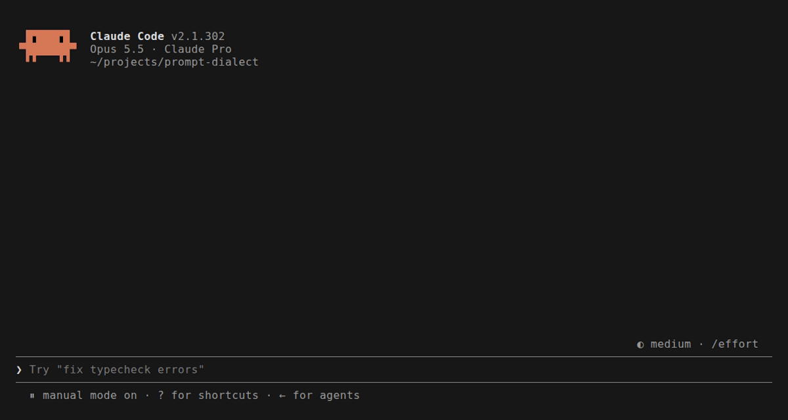

# prompt-dialect: grammar checker and prompt improver for Claude Code

[](https://sonarcloud.io/summary/new_code?id=marcelomiyake_prompt-dialect)
[](https://sonarcloud.io/summary/new_code?id=marcelomiyake_prompt-dialect)

Spelling and grammar checking as you type, and prompt rewrites that follow Anthropic's prompt engineering guidance for the model you use. For the prompts you write to AI coding tools, starting with a [Claude Code](https://code.claude.com) plugin (a mod, in Claude Code's terms: a plugin with a hooks module).



## Features

- **Spell check and grammar fixes as you type.** Pause for a moment and a fast, cheap model (Claude Haiku 5.5 by default) checks the draft for spelling, grammar, punctuation, agreement, wrong words, and phrasing awkward enough to blur the request. Mistakes are underlined in the prompt box, and the band above the prompt lists them. Hover a word to see its fix in context, then click it, or press **Fix all**.
- **A rewrite for your model.** Press **✨ Improve for Opus 5.5** (or whichever model the session uses) and the draft is rewritten to follow Anthropic's prompting guidance for that model: the [Claude prompting best practices](https://platform.claude.com/docs/en/build-with-claude/prompt-engineering/claude-prompting-best-practices) for all models, plus the guide for [Opus 5.5](https://platform.claude.com/docs/en/build-with-claude/prompt-engineering/prompting-claude-opus-5-5), [Opus 5](https://platform.claude.com/docs/en/build-with-claude/prompt-engineering/prompting-claude-opus-5), [Opus 4.8](https://platform.claude.com/docs/en/build-with-claude/prompt-engineering/prompting-claude-opus-4-8), [Sonnet 5.5](https://platform.claude.com/docs/en/build-with-claude/prompt-engineering/prompting-claude-sonnet-5-5), [Sonnet 5](https://platform.claude.com/docs/en/build-with-claude/prompt-engineering/prompting-claude-sonnet-5), [Haiku 5.5](https://platform.claude.com/docs/en/build-with-claude/prompt-engineering/prompting-claude-haiku-5-5), [Fable 5.1](https://platform.claude.com/docs/en/build-with-claude/prompt-engineering/prompting-claude-fable-5-1), or [Fable 5](https://platform.claude.com/docs/en/build-with-claude/prompt-engineering/prompting-claude-fable-5). Claude Mythos models get the Fable guides, and an older model without its own guide gets the oldest guide of its line. **Use it** puts the rewrite in the prompt box, and **Copy** copies it.
- **Rewrites that ask instead of guessing.** Where a missing detail would change the work, the rewrite leaves a short placeholder such as `[which test command?]` rather than inventing one. Up to three notes under it say what changed and why.
- **Leaves your code alone.** The model is told to keep code, identifiers, file paths, URLs, shell commands, `@mentions`, `/commands`, paste placeholders such as `[Pasted text #1]`, and Markdown exactly as written, so it does not trip over the things a general-purpose spellchecker flags in a coding prompt.
- **Keeps your language.** Write in Portuguese, Spanish, German, French, or any other language: the check and the rewrite stay in it and never translate. Languages written without spaces, such as Japanese, have a [known limitation](#known-limitations).
- **No API key to set up.** It calls the model through Claude Code's own API client, and the bundle has no runtime dependencies.

## Install in Claude Code

Requires Claude Code 2.1.301 or later; `claude --version` shows yours. The mods API is in early access and can change between releases. An older build refuses the whole mod when it loads, because it lacks an event the mod hooks (2.1.299 has no `prompt.change`), and it says so only in the debug log.

At the prompt of a Claude Code terminal session:

```
/plugin install prompt-dialect --marketplace marcelomiyake/prompt-dialect
```

Answer `y` to add the marketplace, then choose a scope. From a shell instead:

```
claude plugin install prompt-dialect --marketplace marcelomiyake/prompt-dialect
```

In the desktop app, where `/plugin` does not run: click **+** next to the prompt box, then **Plugins**, **Add marketplace** with `marcelomiyake/prompt-dialect`, then **Add plugin**.

The desktop app runs its own bundled build of Claude Code, not the `claude` on your `PATH`, and updates it on its own schedule. Until that bundled build is 2.1.301 or later, the mod installs but does not run in the desktop app: no band and no `/dialect`, while a terminal session with a newer `claude` runs it. The folder the app keeps the build in is named after its version, for example `~/.config/Claude/claude-code/2.1.299/` on Linux.

## Usage and keyboard shortcuts

| To                              | Do                                                                                                 |
| ------------------------------- | -------------------------------------------------------------------------------------------------- |
| Check a prompt                  | Type it and pause. Drafts under three words, `/commands` and `!shell` lines are skipped.           |
| See a fix                       | Hover the underlined word's chip in the band (fullscreen terminal or desktop).                     |
| Apply a fix                     | Click the chip. From the keyboard, press `ctrl+x` `tab` to focus the band, then the chip's number. |
| Apply every fix                 | **Fix all** (`a` while the band has focus).                                                        |
| Rewrite for the session's model | **✨ Improve for …** (`i`), then **Use it** (`u`) or **Copy** (`c`).                               |
| Hide the band for this draft    | **Hide**. It comes back when you edit the draft.                                                   |
| Turn checking off or on         | `/dialect off`, `/dialect on`. `/dialect` alone shows the status.                                  |

The checks call the model through Claude Code's own API client, so they count toward your usage like any other request: one short call per pause, and one call for each rewrite you ask for. A draft you have already checked is answered from a cache.

### Configuration and settings

Set them in `/config`, or under `pluginConfigs` in your settings:

| Option             | Default            | What it does                                                                            |
| ------------------ | ------------------ | --------------------------------------------------------------------------------------- |
| `checkAsYouType`   | `true`             | Check the prompt whenever you pause. `/dialect on\|off` overrides it and is remembered. |
| `grammarModel`     | `claude-haiku-5-5` | The model that checks the prompt. An alias such as `haiku` works too.                   |
| `improvementModel` | `claude-haiku-5-5` | The model that writes the rewrite.                                                      |
| `debounceMs`       | `900`              | How long you pause, in milliseconds (250 to 10000), before the check runs.              |

### Known limitations

- Underlines appear as soon as the check returns when the cursor is at the end of a short draft. Otherwise they appear on your next keystroke or cursor move, because repainting the box would move the cursor or fold a long draft into a paste placeholder.
- Hover needs a pointer: the fullscreen terminal or the desktop app. Everywhere else, use the keyboard path above.
- Clicking a fix replaces the whole draft with the fixed one, so the cursor moves to the end.
- Languages written without spaces between words, such as Japanese and Chinese, are read in runs of characters between punctuation marks rather than in words: a short draft can be skipped as too short, and a fix underlines the whole run.

## Architecture and how it works

The business logic does not know about Claude Code. It follows Domain-Driven Design and Clean Architecture so that other tools (Codex, Antigravity, OpenCode, VS Code, a CLI) can be added as adapters without touching it.

```
src/
├── core/                      the product, free of any tool's API
│   ├── domain/                TextSpan, TextChange, Suggestion, GrammarReview,
│   │                          TargetModel, PromptingGuide catalog, PromptImprovement
│   └── application/           CheckGrammar and ImprovePrompt use cases,
│       └── ports/             the LanguageModel port the adapters implement
└── adapters/
    └── claude-code/           the mod: hooks, band view, prompt decorations
plugins/claude-code/           the installable mod, bundled from src/ by npm run build
```

- **Grammar checking** asks the model for a corrected copy of the draft, not for positions. The domain diffs the two word by word, so every suggestion points at text that is really there, and a reply that rewrites rather than corrects is discarded.
- **Edits keep the review.** As you type, each suggestion moves with its words. Suggestions that an edit touches are dropped until the next check.
- **Prompting guides are data.** Each model's guidance is an entry in [`src/core/domain/prompting-guides.ts`](src/core/domain/prompting-guides.ts) with its source URL. The catalog picks the guide for the session's model, falling back to the newest guide of that family, so a new model needs one new entry.

[AGENTS.md](AGENTS.md) has the commands, the rules that keep the layers apart, the SonarQube quality gate, and the commit conventions.

## Development and testing

```bash
npm ci
npm run test:coverage          # vitest, with coverage
npm run types:sync             # copy the Claude Code API types (see AGENTS.md)
npm run typecheck
npm run build                  # bundle src/ into plugins/claude-code/hooks/register.js
npm run validate:plugin        # claude plugin validate
npm run test:plugin            # claude plugin test, inside Claude Code's engine
claude --plugin-dir plugins/claude-code   # try it
vhs docs/demo.tape                        # re-record docs/demo.gif (calls the model)
```

## Support

- **Questions and bugs:** [open an issue](https://github.com/marcelomiyake/prompt-dialect/issues). Include your Claude Code version and the plugin version.
- **Security problems:** report them privately, as [SECURITY.md](SECURITY.md) describes. Do not open a public issue.
- **Anything else:** email **CONTACT_EMAIL**.

## License

[MIT](LICENSE)
